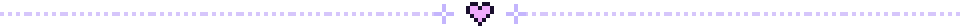
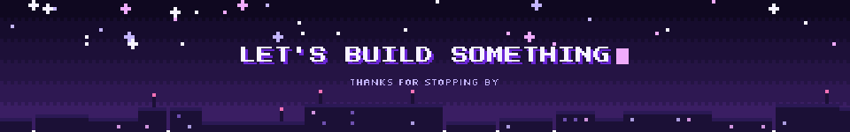

<!-- ✦ Alejandra's profile README · pixel edition ✦ -->

<p align="center">
  
</p>

<p align="center">
  
  
  
</p>

<p align="center">
  <a href="https://www.linkedin.com/in/alejandra-reyes-arys"></a>
  <a href="https://portfolio-ar-henna.vercel.app"></a>
  <a href="mailto:alejandranireyes06@gmail.com"></a>
</p>



## ✦ whoami

I'm **Alejandra Nicolle Reyes Rodríguez**, a **Computer Systems Engineering** student at **UNITEC** in Tegucigalpa, Honduras 🇭🇳

Over the past year I've built **four web projects that are now live** — from a full-stack restaurant website with its own CMS, to an AI- and blockchain-powered learning platform built with my team at a global hackathon, to a marketplace MVP.

I work with **React, React Native, JavaScript and Node.js**, I **test what I build** (functionality, performance, every device and browser I can get my hands on), and I'm especially into **educational technology** 💜

```js
const alejandra = {
  studying:   "Computer Systems Engineering @ UNITEC",
  basedIn:    "Tegucigalpa, Honduras",
  stack:      ["React", "React Native", "Node.js", "Supabase"],
  shipped:    4, // live web projects (and counting)
  favorite:   "ed-tech",
  languages:  ["Spanish (native)", "English (advanced)"],
};
```


## ✦ Tech Stack

<p align="center">
  <br/>
  
</p>

**Languages:** `JavaScript` · `SQL` · `Java` · `C++` · `Python (basic)`<br/>
**Frontend & Mobile:** `React` · `React Native` · `HTML5` · `CSS3` · `Responsive design`<br/>
**Backend & Databases:** `Node.js` · `Supabase (PostgreSQL)` · `MongoDB`<br/>
**Testing & Quality:** `Functional testing` · `Cross-browser & cross-device testing` · `Debugging`<br/>
**Tools:** `Git` · `GitHub` · `Vercel` · `Figma` · `Solana / Web3`


## ✦ Featured Projects

<p align="center">
  <a href="https://laoficinabar.com"></a>
  <a href="https://besteamhn-ai-tutor.vercel.app"></a>
</p>
<p align="center">
  <a href="https://colmena-lilac.vercel.app"></a>
  <a href="https://besteamhn-landingpage.vercel.app"></a>
</p>

<details>
<summary><b>✦ La Oficina</b> — full-stack restaurant website + custom CMS · <i>Nov 2025 – Mar 2026</i></summary>
<br/>

🔗 [laoficinabar.com](https://laoficinabar.com) · Academic project · React, Node.js, Supabase, HTML, CSS

- Developed and launched the restaurant's website, including a **custom admin panel (CMS)** to manage the menu and content from a database.
- Tested functionality, load performance and design **across devices and browsers**, catching display and behavior bugs before launch.

</details>

<details>
<summary><b>✦ BeSteamHN AI Tutor</b> — Global Web3Pack Hackathon (Dev3pack) · <i>May 2026</i></summary>
<br/>

🔗 [besteamhn-ai-tutor.vercel.app](https://besteamhn-ai-tutor.vercel.app) · Team project · Global hybrid hackathon

- Co-developed an **AI-powered educational web platform** with interactive courses and module-based progression.
- Integrated and tested **NFT certificates on the Solana blockchain** and validated core flows before the final demo.

</details>

<details>
<summary><b>✦ Colmena</b> — creative services platform (MVP) · <i>Sep 2026</i></summary>
<br/>

🔗 [colmena-lilac.vercel.app](https://colmena-lilac.vercel.app) · Web development & entrepreneurship project

- Developed a responsive web prototype that **connects businesses with creative students and freelancers**.
- Built the key interfaces: project creation, proposals, portfolios and service selection.

</details>

<details>
<summary><b>✦ BeSteamHN Landing Page</b> · <i>Aug 2026</i></summary>
<br/>

🔗 [besteamhn-landingpage.vercel.app](https://besteamhn-landingpage.vercel.app) · Web project

- Developed a responsive landing page that brings **BeSteamHN's visual identity** to the web.

</details>


## ✦ Giving Back

**Volunteer Facilitator · BeSteamHN Workshops — _"Introduction to the Digital Age"_**<br/>
SOS Children's Villages Honduras (Aldeas SOS) · Apr 2026

- Taught children **computational thinking, algorithms and basic programming** using Python and Scratch.
- Helped bring technology education to communities in Honduras with limited access to it.


## ✦ GitHub Stats

<p align="center">
  
  
</p>

<p align="center">
  
</p>

<p align="center">
  
</p>

<p align="center">
  <picture>
    <source media="(prefers-color-scheme: dark)" srcset="https://raw.githubusercontent.com/reyes-ale/reyes-ale/output/snake-dark.svg" />
    
  </picture>
</p>

<p align="center">
  
</p>

